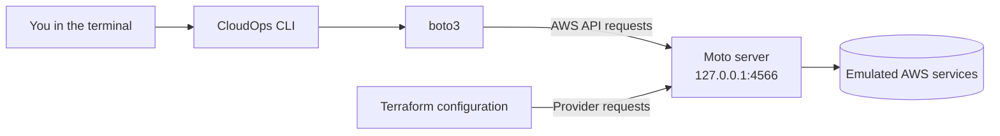

<div align="center">

<h1 align="center"><strong>☁️ CloudOps CLI</strong></h1>

### Local-first AWS automation from your terminal.

A Python command-line tool for selected AWS resource operations, built with **boto3** and **Click** and designed for local development against an AWS-compatible emulator such as **Moto**.

<p>
  
  
  
  
  
  
</p>

**An independent DevOps automation project by [Ziad](https://github.com/2nothing4).**

</div>

---

## ✨ Overview

CloudOps CLI brings a focused set of cloud operations into one command-line interface. It uses `boto3` to interact with AWS APIs and is designed to be exercised against a local AWS-compatible endpoint.

> [!IMPORTANT]
> **Project status:** Personal DevOps automation project · Active development  
> The documented workflow is intended for local development and testing. This project is **not presented as a production AWS management tool**.

## ⚡ Features

The commands currently documented in this repository are:

| Command | Description |
|:--|:--|
| `cloudops health` | Checks connectivity to the configured local AWS emulator. |
| `cloudops s3-list` | Lists S3 buckets visible to the configured endpoint. |
| `cloudops ec2-create --name <name>` | Creates an EC2 instance using the configured endpoint. |
| `cloudops ec2-list` | Lists EC2 instances visible to the configured endpoint. |
| `cloudops ec2-terminate <instance-id>` | Requests termination of the specified instance. |

The repository also contains a Terraform configuration intended to provision an EC2 instance against a local AWS-compatible endpoint. Its behavior depends on the provider configuration and the API operations supported by the selected emulator.

## 🧭 Architecture & workflow

The local workflow uses the CLI and Terraform as separate clients of the Moto emulator:



> [!NOTE]
> Starting Moto does not automatically configure the CLI or Terraform. **Each client must be configured to use the intended endpoint.**

---

## 🚀 Quick start

### 1. Clone the repository

```bash
git clone https://github.com/2nothing4/cloudops-cli.git
cd cloudops-cli
```

### 2. Create a virtual environment

#### Linux / macOS

```bash
python3 -m venv .venv
source .venv/bin/activate
```

#### Windows · PowerShell

```powershell
py -m venv .venv
.\.venv\Scripts\Activate.ps1
```

If PowerShell blocks virtual-environment activation, allow it for the **current process only** and activate the environment again:

```powershell
Set-ExecutionPolicy -Scope Process -ExecutionPolicy Bypass
.\.venv\Scripts\Activate.ps1
```

### 3. Install the CLI and Moto

Run these commands after activating the virtual environment:

```bash
python -m pip install --upgrade pip
python -m pip install -e .
python -m pip install "moto[server]"
```

The editable installation (`pip install -e .`) installs the CLI and the dependencies declared by the project. Moto server mode is installed separately for the local emulator workflow described below.

### 4. Start the Moto server

In the first terminal, start Moto on the loopback interface:

```bash
moto_server -H 127.0.0.1 -p 4566
```

Keep the server running. Open a **second terminal**, activate the same virtual environment, and continue with the CLI commands.

> [!IMPORTANT]
> Confirm that the CLI's boto3 client is configured to use `http://127.0.0.1:4566`. Check the endpoint configuration in the application source. Do not assume the CLI is connected to Moto just because the server is running.

### 5. Run the CLI commands

```bash
# Check connectivity to the configured emulator
cloudops health

# List S3 buckets
cloudops s3-list

# Create an EC2 test instance
cloudops ec2-create --name my-server

# List EC2 instances
cloudops ec2-list
```

An empty S3 bucket list can be normal when the emulator has not been initialized with any buckets.

### 6. Terminate the test instance

Use an instance ID returned by `cloudops ec2-list`:

```bash
cloudops ec2-terminate i-xxxxxxxx
```

> [!WARNING]
> Termination is a destructive operation. Before running it, confirm that the CLI is targeting your local emulator and that the instance ID belongs to the test environment you intend to clean up.

---

## 🏗️ Infrastructure as Code · Terraform

The `terraform/` directory contains an EC2-oriented Terraform configuration intended for a local AWS-compatible endpoint.

### Before applying

1. Inspect the AWS provider configuration and verify the EC2 endpoint.
2. Confirm that the configuration uses local test credentials—not real AWS credentials.
3. Check that the selected emulator supports the resources and API calls used by the configuration.
4. Do not assume a configuration tested against one emulator will work unchanged against another.

### Validate and plan

Run these commands from the repository root:

```bash
cd terraform
terraform fmt -check
terraform init
terraform validate
terraform plan
```

Review the plan carefully. Apply only after verifying that it targets the intended local emulator:

```bash
terraform apply
```

### Clean up

When testing is complete, review and remove the test infrastructure:

```bash
terraform plan -destroy
terraform destroy
```

> [!CAUTION]
> Do not use `-auto-approve` for this workflow. Reviewing the plan is part of the safety check. Do not run the example configuration against a real AWS account without adapting and reviewing it first.

---

## 🧪 Testing & validation

The currently documented workflow uses **manual local smoke checks**. This README does not claim that an automated `pytest` suite is available.

| Check | Expected result |
|:--|:--|
| Start Moto on `127.0.0.1:4566` | The local emulator starts and remains running. |
| `cloudops health` | Reports a successful connection to the configured endpoint. |
| `cloudops s3-list` | Returns successfully; an empty list is acceptable for a new emulator. |
| `cloudops ec2-create --name my-server` | Creates a test instance in the configured emulator. |
| `cloudops ec2-list` | Shows the test instance. |
| `cloudops ec2-terminate <instance-id>` | Terminates the test instance; a subsequent list should no longer show it. |
| Terraform validation | `fmt`, `init`, `validate` and `plan` complete against the intended configuration. |

Automated unit and integration tests, together with a documented test command, should be added when the test suite and development dependencies are present in the repository.

---

## 🧰 Technology stack

| Technology | Role |
|:--|:--|
| [Python](https://www.python.org/) | CLI implementation |
| [Click](https://click.palletsprojects.com/) | Command-line interface framework |
| [boto3](https://boto3.amazonaws.com/v1/documentation/api/latest/index.html) | AWS SDK for Python |
| [Moto](https://docs.getmoto.org/) | AWS service mocking and local server mode |
| [Terraform](https://developer.hashicorp.com/terraform/docs) | Infrastructure as Code for the EC2 example |

## 🔐 Security & safe usage

- Use local test credentials with an emulator. Never commit real AWS access keys, secret keys, tokens or credential files.
- Keep Moto bound to `127.0.0.1` for local-only use. Do not expose an unauthenticated emulator to an untrusted network.
- Verify the configured endpoint before creating or terminating resources.
- Treat Terraform state files and saved plan files as potentially sensitive. Keep them out of Git unless there is a deliberate, reviewed reason to publish a sanitized example.
- Do not run the example Terraform configuration against a real AWS account without adapting and reviewing the configuration first.

## 📍 Scope & current limitations

- The documented CLI command set is limited to the S3 and EC2 operations listed above, plus the health check.
- The documented workflow is for local development and testing; no production AWS deployment is claimed.
- Automated test coverage is not documented as available yet.
- Terraform behavior depends on its provider configuration and the selected emulator's API compatibility.
- The project is under active development; commands and configuration may evolve.

## 📚 References

- [Moto · Server mode](https://docs.getmoto.org/en/latest/docs/server_mode.html)
- [boto3 · Documentation](https://boto3.amazonaws.com/v1/documentation/api/latest/index.html)
- [Click · Documentation](https://click.palletsprojects.com/)
- [Terraform AWS Provider · Documentation](https://registry.terraform.io/providers/hashicorp/aws/latest/docs)

---

<div align="center">

### Built by [Ziad](https://github.com/2nothing4)

[Repository](https://github.com/2nothing4/cloudops-cli) · [GitHub profile](https://github.com/2nothing4)

*Learning by building. Automating one operation at a time.*

</div>
